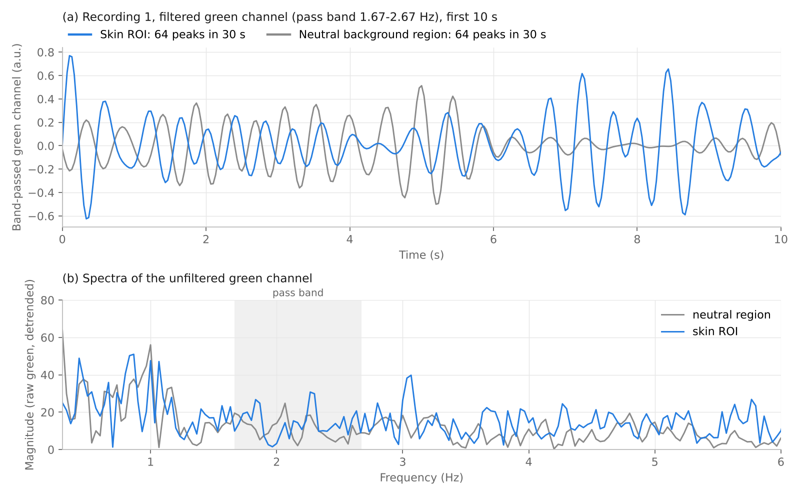
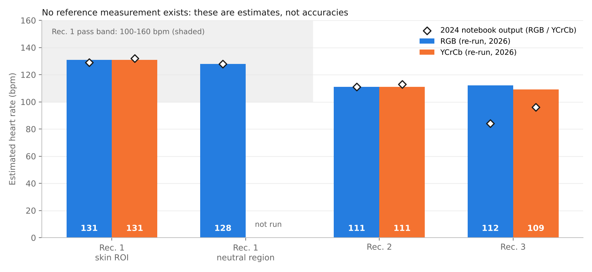

# Video-Based Heart Rate Estimation

Exploratory remote photoplethysmography (rPPG): heart rate from the periodic colour variation of a small skin region in a video, with a negative-control analysis on a background region.

<p align="center">
  
</p>

> **Status.** Exploratory analysis written in 2024, not actively maintained. No reference heart rate (pulse oximeter, ECG) was recorded, so the accuracy of the estimates has **not** been assessed. The negative control below shows that the method, as implemented, does **not** demonstrate that its estimates come from a cardiac signal.

> **Context.** Developed in 2024 during my engineering studies at [ESEO](https://www.eseo.fr), within study and research projects carried out in collaboration with ESEO. Exploratory scope: this is not a clinical study and makes no claim of clinical validity.

| | |
|---|---|
| **Input** | Three short videos, 30 frames per second (not distributed, see [`data/README.md`](data/README.md)). |
| **Output** | Heart-rate estimate (bpm) per recording, from RGB and from YCrCb channels. |
| **Key finding** | On recording 1, a neutral background region gives the same estimate as the skin region (128 vs 131 bpm; 64 vs 64 peaks in the green channel). |
| **Code** | Python notebook, OpenCV / NumPy / SciPy / Matplotlib. |

## Overview

The heartbeat slightly modulates the light reflected by skin. The notebook averages each colour channel over a 5 x 5 pixel region of interest (ROI) in every frame, band-pass filters the resulting time series, counts the peaks and converts the count to beats per minute. A neutral region of the same size, taken in the background of recording 1, serves as a negative control.

## Method

All steps are in [`notebooks/video_heart_rate.ipynb`](notebooks/video_heart_rate.ipynb).

1. Select the ROI (and, for recording 1, a neutral region) with a mouse click; the click gives the top-left corner of a fixed 5 x 5 pixel region.
2. Mean R, G, B value of the ROI in each frame.
3. 4th-order Butterworth band-pass filter (zero phase): 1.67-2.67 Hz (100-160 bpm) for recording 1, 0.7-3 Hz (42-180 bpm) for recordings 2 and 3, assuming 30 frames per second.
4. Peak detection (`find_peaks(height=0)`) on each filtered channel. Heart rate = mean peak count of the three channels x 60 / clip duration, where the duration is typed into the notebook. The code prints `int(value) + 1`.
5. FFT of the filtered signals.
6. The same analysis in the YCrCb colour space.
7. Negative control on the neutral region, then recordings 2 and 3.

## Results

<p align="center">
  
</p>

| Recording | Clip | Pass band | RGB (bpm) | YCrCb (bpm) | 2024 notebook output (RGB / YCrCb) |
|---|---|---|---|---|---|
| 1, skin ROI | 30 s | 1.67-2.67 Hz | 131 | 131 | 129 / 132 |
| 1, neutral region | 30 s | 1.67-2.67 Hz | 128 | not run | 128 / not run |
| 2 | 10 s | 0.7-3 Hz | 111 | 111 | 111 / 113 |
| 3 | 30 s | 0.7-3 Hz | 112 | 109 | 84 / 96 |

The "RGB" and "YCrCb" columns are the outputs saved in the notebook (re-run in 2026). The last column gives the values recorded by the original 2024 run.

**Reproducibility.** Re-running the notebook with the same code and the same click coordinates, but a newer OpenCV (5.0.0), changes the peak counts by 1 to 3 on recordings 1 and 2, and changes the estimate for recording 3 from 84 / 96 to 112 / 109 bpm. The cause was not investigated; a difference in video decoding is a plausible candidate but is not verified. Either way, the estimates are sensitive to details that do not change the underlying signal.

## Limitations

- **The negative control does not discriminate.** The neutral region gives 128 bpm against 131 bpm for the skin ROI, and 64 peaks in both. The arithmetic centre of the 1.67-2.67 Hz pass band corresponds to 130 bpm, which is where all three recording-1 estimates fall. In the unfiltered green channel, neither region shows a distinct spectral peak inside the pass band (panel b above).
- No reference heart rate; no error metric.
- Peaks are counted without minimum distance or prominence constraints, so noise peaks inside the pass band are counted.
- Clip durations and the frame rate are hard-coded (recording 3 is 29.97 fps, not 30). ROI selection is manual and interactive (it opens an OpenCV window, so a display is required).
- The recordings come from three different scenes; no inference about accuracy across subjects or conditions can be drawn from three clips.

## Audit notes (2026)

Corrections made to the notebook while translating it, none of which changes a peak count:

- In the YCrCb sections of recordings 2 and 3, the "Cr (filtered)" and "Cb (filtered)" plots drew the RGB green and blue curves instead of the Cr and Cb curves.
- The legends of the RGB spectra were labelled Y, Cr and Cb.
- Comments and titles stated a 0.67-2.67 Hz pass band and 3 x 3 or 10 x 10 pixel regions; the code uses the bands above and 5 x 5 pixels.

The preview frames shown during ROI selection were removed from the saved outputs because they show people.

## Repository structure

```
notebooks/video_heart_rate.ipynb   analysis notebook
data/videos/                       place your own videos here (not distributed)
data/README.md                     data description
assets/                            figures above
requirements.txt
CITATION.cff
LICENSE
```

## Reproducing

```bash
python -m venv .venv && source .venv/bin/activate
pip install -r requirements.txt
# put recording_1.mp4, recording_2.mp4, recording_3.mp4 in data/videos/
cd notebooks && jupyter lab        # open video_heart_rate.ipynb and run all cells
```

The saved outputs come from a run with Python 3.13, OpenCV 5.0.0, NumPy 2.5.3, SciPy 1.18.1 and Matplotlib 3.11.2. In that run the mouse clicks were replayed from the coordinates listed in the notebook introduction. Running interactively needs a display.

## Citation and licence

See [`CITATION.cff`](CITATION.cff). Code released under the [MIT licence](LICENSE).

Author: Jean-Eudes Beucher
